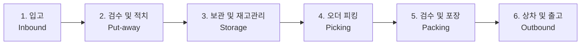

# 🔄 [Chapter 4] 물류 핵심 프로세스 흐름

## 1. 센터 전체 프로세스 맵 (End-to-End)
물류센터의 상품 흐름은 입고부터 출고까지 아래와 같이 유기적으로 연결되어 동작합니다.

---

## 2. 세부 공정별 핵심 업무

### 2.1 입고 (Inbound)
- **차량 접안 및 하차**: 도크에 도착한 납품 트럭에서 파렛트 단위 하차.
- **외관 검수**: 박스 찌그러짐, 젖음, 오염 등 운송 중 파손 여부 1차 육안 점검.
- **인수증 대조**: 납품 전표와 실제 입고 품목/수량 일치 여부 확인.

### 2.2 검수 및 적치 (Put-away)
- **바코드 검수**: 상품 바코드(EAN/UPC)를 스캔하여 WMS 시스템에 입고 확정 등록.
- **로케이션 배정**: WMS가 추천하는 최적 선반 로케이션(행-열-단)으로 이동.
- **적치 완료**: 해당 선반 바코드를 스캔하여 재고를 로케이션에 물리적·전산적으로 귀속.

### 2.3 보관 및 재고 관리 (Storage & Inventory)
- **선입선출 (FIFO)**: 유통기한 또는 먼저 입고된 상품이 우선 출고되도록 관리.
- **순환 재고실사 (Cycle Count)**: 일별 지정 구역의 전산 재고와 실물 재고 일치 여부 전수 검증.

### 2.4 오더 피킹 (Order Picking)
- **피킹 리스트 수령**: PDA 단말기를 통해 출하 지시 및 피킹 동선 수신.
- **피킹 방식**:
  - *단품 피킹 (Single Picking)*: 1건 주문씩 이동하여 피킹
  - *토털/배치 피킹 (Batch Picking)*: 여러 주문의 동일 상품을 한 번에 피킹 후 분류대로 이동.
- **확인 스캔**: 로케이션 스캔 ➜ 상품 바코드 스캔으로 오피킹 차단.

### 2.5 검수 및 포장 (Packing)
- **출하 검수**: 포장 스테이션에서 상품 바코드 최종 스캔 및 주문 건 대조.
- **패킹 작업**: 상품 크기에 맞는 규격 박스 선택, 완충재(에어캡/종이 완충재) 적정 투입.
- **송장 부착**: 자동 출력된 배송 라벨 송장을 박스 상단 지정 위치에 부착.

### 2.6 출고 및 상차 (Outbound)
- **권역별 분류**: 배송 지역(수도권, 영남, 호남 등 라우팅 코드)별 롤테이너/파렛트로 분류.
- **간선차 상차**: 적재 효율 및 상품 파손 방지를 고려하여 차량 내 빈틈없이 상차 완료.

---
> 다음 장: **[Chapter 5] WMS 시스템 및 PDA 기본 사용법**
